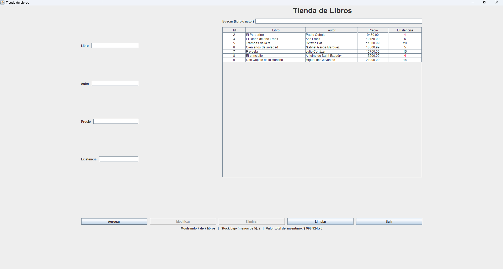
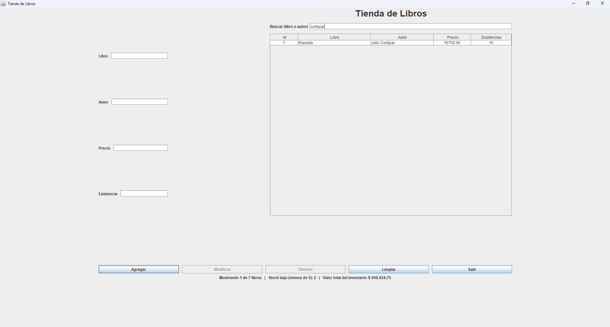
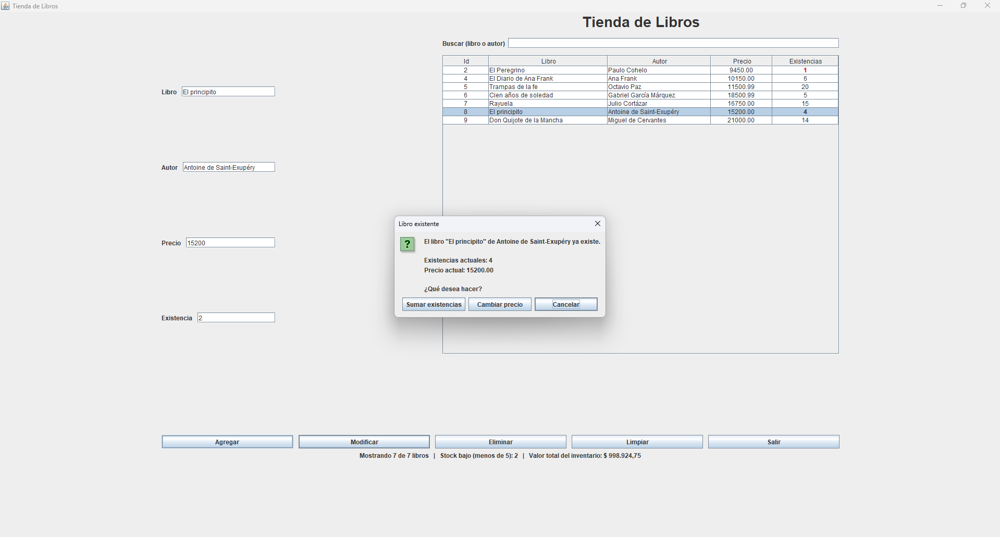
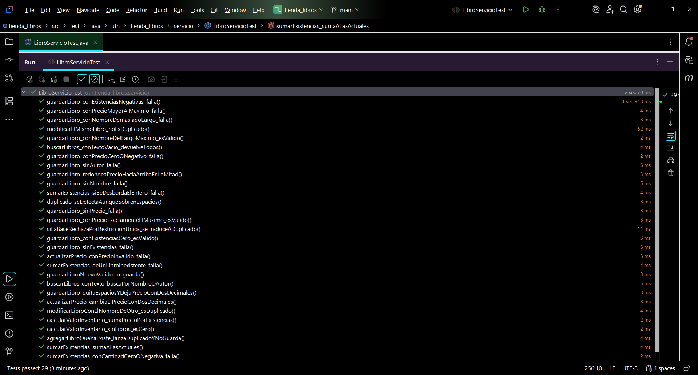

# Tienda de Libros

[](https://github.com/GustavoRodriguez79/tienda-libros/actions/workflows/maven.yml)

Aplicación de escritorio para la gestión de un catálogo de libros, desarrollada con **Java**, **Spring Boot** y **Swing**, persistiendo los datos en **MySQL** mediante **Spring Data JPA / Hibernate**.

Proyecto de práctica personal — Tecnicatura Universitaria en Programación (TUP), UTN San Rafael.

---

## Características

- CRUD completo de libros: **Agregar**, **Modificar**, **Eliminar** y **Listar**.
- Interfaz gráfica de escritorio construida con Swing (GUI Designer de IntelliJ).
- Selección de fila en la tabla: al hacer clic en un libro, sus datos se cargan automáticamente en el formulario para editarlo o eliminarlo. Solo se puede seleccionar un libro a la vez y las celdas de la tabla no son editables.
- Validación de datos: no se aceptan campos vacíos, precios o existencias que no sean números, valores negativos ni precios fuera del rango de la base de datos. Ante un error se muestra un aviso y el cursor queda en el campo a corregir.
- Confirmación antes de eliminar un libro y antes de salir de la aplicación.
- **Control de duplicados:** si se intenta agregar un libro que ya existe (mismo título y autor, sin importar mayúsculas ni espacios), la aplicación avisa y ofrece **sumar existencias** o **cambiar el precio** del libro existente. La base de datos refuerza la regla con una restricción única.
- **Buscador** por título o autor que filtra la tabla mientras se escribe.
- **Stock bajo resaltado:** las existencias menores a 5 se muestran en rojo y negrita.
- **Resumen del inventario:** cantidad de libros, cuántos tienen stock bajo y valor total (precio × existencias).
- Las reglas de negocio viven en la capa de servicio y tienen **pruebas unitarias** (JUnit 5 y Mockito).
- Botones **Limpiar** (para empezar un libro nuevo) y **Salir**; **Modificar** y **Eliminar** solo se habilitan con un libro seleccionado.
- Manejo de errores de base de datos: si algo falla, se informa al usuario en lugar de cerrar la aplicación.
- Precios manejados con `BigDecimal` (en vez de `Double`), para evitar errores de precisión decimal típicos al trabajar con dinero.
- Creación automática de la base de datos si no existe (`createDatabaseIfNotExist=true`).
- Actualización automática del esquema de tablas según las entidades (`spring.jpa.hibernate.ddl-auto=update`).

---

## Capturas de pantalla

### Formulario principal



*El formulario con el listado de libros, el buscador, y la barra de resumen del inventario. Los libros con menos de 5 existencias se muestran en rojo y negrita. Al hacer clic en una fila de la tabla, sus datos se cargan automáticamente en los campos de la izquierda, listos para modificar o eliminar.*

### Buscador



*Al escribir en el campo "Buscar" la tabla se filtra en el momento, por título o autor, sin distinguir mayúsculas y, con la configuración habitual de MySQL, tampoco tildes (acá, "cortazar" encuentra a Julio Cortázar). El resumen de abajo indica cuántos libros se muestran sobre el total.*

### Control de duplicados



*Si se intenta agregar un libro que ya existe, la aplicación no crea una copia: muestra las existencias y el precio actuales y ofrece **Sumar existencias**, **Cambiar precio** o **Cancelar**.*

---

## Cómo funciona

1. **Al iniciar la aplicación**, se consulta la base de datos y se listan todos los libros existentes en la tabla.
2. **Agregar un libro nuevo:** se completan los 4 campos (Libro, Autor, Precio, Existencia) y se presiona **Agregar**. El libro se guarda en la base y la tabla se actualiza automáticamente. Si ese libro ya existe, se ofrece sumar existencias o cambiar el precio en lugar de crear una copia.
3. **Modificar un libro:** se hace clic sobre la fila correspondiente en la tabla — esto carga sus datos en los campos de texto. Se edita lo que haga falta y se presiona **Modificar** para guardar los cambios.
4. **Eliminar un libro:** se selecciona la fila igual que para modificar, y se presiona **Eliminar** para borrarlo de la base de datos.
5. **Limpiar:** quita la selección de la tabla y vacía los campos para cargar un libro nuevo.
6. **Buscar:** el campo de arriba de la tabla filtra los libros por título o autor a medida que se escribe. Abajo se muestra el resumen del inventario.
7. **Salir:** cierra la aplicación previa confirmación (la "X" de la ventana hace lo mismo) y libera la conexión a la base de datos.
8. Tras cualquier operación (agregar, modificar o eliminar), el formulario se limpia y la tabla se refresca para reflejar el estado actual de la base.

**Reglas de validación** (se aplican en la capa de servicio): Libro y Autor no pueden estar vacíos ni superar los 100 caracteres; el Precio debe ser un número entre 0.01 y 99999999.99 (acepta punto o coma decimal); la Existencia debe ser un entero mayor o igual a cero; no puede haber dos libros con el mismo título y autor.

---

## Tecnologías utilizadas

| Tecnología | Uso |
|---|---|
| Java 21 | Lenguaje principal |
| Spring Boot | Inyección de dependencias, configuración de la aplicación |
| Spring Data JPA / Hibernate | Persistencia y mapeo objeto-relacional |
| MySQL | Base de datos |
| Swing | Interfaz gráfica de escritorio |
| Lombok | Reducción de código repetitivo (getters, setters, constructores, `toString`) |
| JUnit 5 y Mockito | Pruebas unitarias de la capa de servicio |
| Maven | Gestión de dependencias y build |

---

## Estructura del proyecto

```
tienda_libros/
├── src/main/java/utn/tienda_libros/
│   ├── TiendaLibrosApplication.java   # Punto de entrada (arranca Spring + Swing)
│   ├── modelo/
│   │   └── Libro.java                 # Entidad JPA
│   ├── excepcion/
│   │   ├── LibroInvalidoException.java   # Datos que no cumplen las reglas
│   │   └── LibroDuplicadoException.java  # Libro repetido (mismo título y autor)
│   ├── repositorio/
│   │   └── LibroRepositorio.java      # Interfaz JpaRepository
│   ├── servicio/
│   │   ├── ILibroServicio.java        # Contrato del servicio
│   │   └── LibroServicio.java         # Lógica de negocio (validaciones, duplicados, cálculos)
│   └── vista/
│       ├── LibroFrom.java             # Lógica del formulario Swing
│       └── LibroFrom.form             # Diseño visual (GUI Designer)
├── src/main/resources/
│   ├── application.properties         # Configuración de conexión a MySQL
│   └── logback-spring.xml             # Configuración de logging
└── src/test/java/utn/tienda_libros/servicio/
    └── LibroServicioTest.java         # Pruebas unitarias del servicio
```

---

## Requisitos previos

- JDK 21 o superior
- Maven
- MySQL Server 8.x corriendo en `localhost:3306`
- IntelliJ IDEA (recomendado, por el soporte nativo al GUI Designer de Swing)

---

## Configuración

Editá `src/main/resources/application.properties` con tus credenciales de MySQL:

```properties
# Conexion a MySQL
spring.datasource.url=jdbc:mysql://localhost:3306/tienda_libro_practica_db?createDatabaseIfNotExist=true
spring.datasource.username=root
spring.datasource.password=${DB_PASSWORD}
spring.datasource.driver-class-name=com.mysql.cj.jdbc.Driver

# Crear o actualizar las tablas segun las entidades
spring.jpa.hibernate.ddl-auto=update
spring.jpa.show-sql=true
```

> **Nota:** `${DB_PASSWORD}` toma el valor de una variable de entorno. Si preferís no usar variables de entorno, reemplazala directamente por tu contraseña de MySQL.

No hace falta crear la base de datos ni las tablas manualmente: Hibernate las genera automáticamente al iniciar la aplicación por primera vez.

---

## Cómo ejecutar

1. Cloná el repositorio:
   ```bash
   git clone git@github.com:GustavoRodriguez79/tienda-libros.git
   cd tienda-libros
   ```
2. Configurá `application.properties` como se indicó arriba.
3. Ejecutá la clase principal `TiendaLibrosApplication.java` desde IntelliJ (o con Maven):
   ```bash
   mvn spring-boot:run
   ```
4. Se abrirá la ventana **"Tienda de Libros"**, lista para usar.

---

## Pruebas

Las pruebas unitarias de `LibroServicio` no necesitan base de datos. Se ejecutan con:

```bash
mvn test
```

(o desde IntelliJ, con clic derecho sobre `LibroServicioTest` → *Run*).

Hay **29 pruebas** que cubren las validaciones (campos vacíos, largos máximos, precios y existencias fuera de rango), el redondeo del precio, la detección de duplicados, la búsqueda, las operaciones de sumar existencias y cambiar precio, y el cálculo del valor del inventario.



> **Nota:** `TiendaLibrosApplicationTests` levanta el contexto completo de Spring, por lo que necesita MySQL en marcha y la variable `DB_PASSWORD`. Las pruebas de `LibroServicioTest` no la necesitan.

---

## Entidad `Libro`

| Campo | Tipo | Descripción |
|---|---|---|
| `idLibro` | `Integer` | Clave primaria, autogenerada |
| `nombreLibro` | `String` | Título del libro |
| `autor` | `String` | Autor del libro |
| `precio` | `BigDecimal` | Precio, con 2 decimales de precisión |
| `existencias` | `Integer` | Cantidad disponible en stock |

`nombreLibro` y `autor` son obligatorios (máximo 100 caracteres) y la combinación de ambos es única en la base de datos.

---

## Documentación

**Arquitectura por capas.** Cada capa tiene una única responsabilidad y solo conoce a la de abajo:

| Capa | Paquete | Responsabilidad |
|---|---|---|
| Vista | `vista` | Pantalla Swing: lee los campos, muestra mensajes y la tabla. No tiene reglas de negocio |
| Servicio | `servicio` | Validaciones, detección de duplicados, búsqueda y cálculos. Lanza `LibroInvalidoException` o `LibroDuplicadoException` |
| Repositorio | `repositorio` | Acceso a datos con Spring Data JPA |
| Modelo | `modelo` | Entidad `Libro` mapeada a la tabla `libro` |

**Flujo de "Agregar":** la vista convierte los textos en números y llama a `guardarLibro` → el servicio limpia y valida los datos, busca si ya existe otro libro con el mismo título y autor → si no existe, el repositorio lo guarda; si existe, se lanza `LibroDuplicadoException` y la vista ofrece sumar existencias o cambiar el precio.

**Código documentado con Javadoc.** Las clases y métodos públicos explican su propósito en comentarios `/** ... */`, que IntelliJ muestra al pasar el mouse (`Ctrl + Q`). Para generar la documentación en HTML:

```bash
mvn javadoc:javadoc
```

El resultado queda en `target/reports/apidocs/index.html`.

---

## Autor

**Gustavo Ariel Rodriguez**
Tecnicatura Universitaria en Programación (TUP) — UTN San Rafael
[GitHub: GustavoRodriguez79](https://github.com/GustavoRodriguez79)
